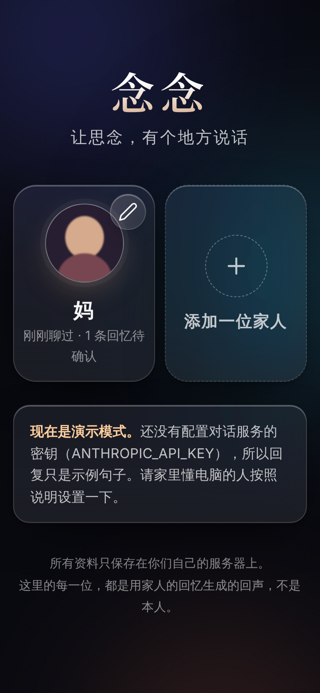
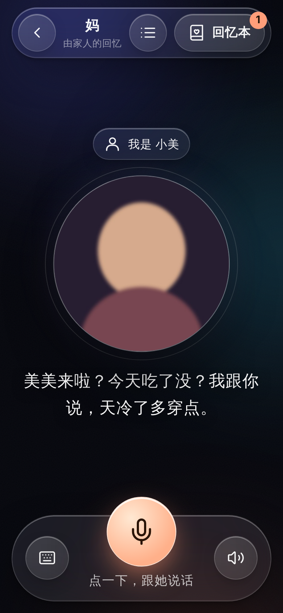
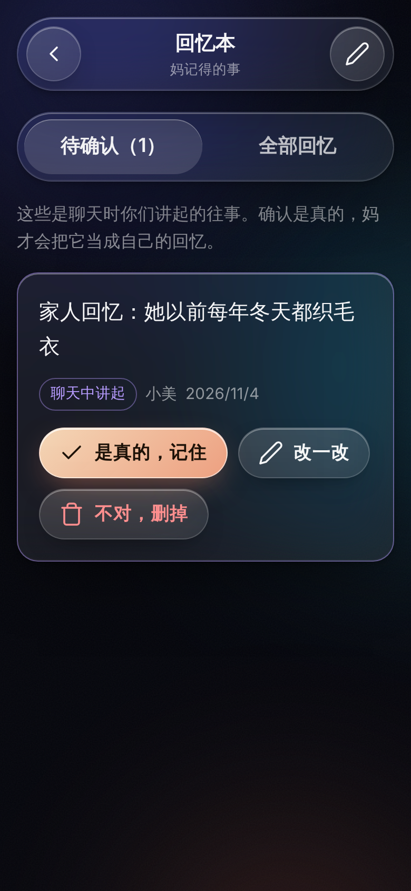

# 念念 · Niannian

> 让思念，有个地方说话。

把一位离开的家人的回忆（性格、习惯、口头禅、故事、照片、声音）放进来，就能像以前那样和 TA 说说话。
聊天时家人讲起的近况，TA 会记住，下次主动问起；家人讲起的往事，经家人确认后，成为 TA 的回忆。

<p>
  
  
  
</p>

---

## 一、快速开始

需要 **Node.js 22 或更新版本**。

```bash
npm install
cp .env.example .env     # 然后编辑 .env，填入密钥
npm start                # 打开 http://localhost:3000
```

| 配置项 | 必需？ | 作用 |
|---|---|---|
| `ANTHROPIC_API_KEY` | 建议填 | 对话大脑（Claude，默认 `claude-opus-5-5`）。不填会进入「演示模式」，只回示例句子。 |
| `ELEVENLABS_API_KEY` | 可选 | 用上传的录音克隆 TA 的声音，并提供在各地都能用的语音识别。不填就用设备自带的中文朗读。 |
| `APP_PASSCODE` | **放到公网前必填** | 打开 App 需要输入口令（用户名随便填）。 |
| `CLAUDE_MODEL` | 可选 | 换对话模型。 |

手机上使用：用手机浏览器打开电脑的局域网地址（例如 `http://192.168.1.8:3000`），再「添加到主屏幕」，就像一个 App。
注意：手机浏览器只在 **HTTPS** 或 `localhost` 下才允许使用麦克风。家庭局域网里可以用 Caddy / Tailscale 等给它加上 HTTPS。

## 二、怎么用（给家里每个人）

1. **添加一位家人**：名字 → 照片 → 声音 → 性格 → 家里都有谁 → 喜好习惯 → 故事 → 边界。只有名字必填，其余随时可补。每个大文本框旁都有麦克风，可以直接说，不用打字。
2. **对话**：点中间的大圆按钮说话，说完停一下会自动结束；TA 说话时再点一下可以打断。不方便说话就点左边的键盘打字。
3. **回忆本**：
   - 「待确认」里是聊天时你们讲起的往事。点「是真的，记住」，TA 才会把它当成自己的回忆。
   - 「全部回忆」里可以随时写下新的回忆。

## 三、人物的维度

你最初想到的是「喜好、习惯、性格」。这三样远远不够让一个人「像」本人。真正让人一听就认出来的，往往是下面这些。App 里每一项都有对应的位置：

| 维度 | 为什么重要 | 在 App 哪里 |
|---|---|---|
| **语言指纹**：口头禅、方言、语气词、句子长短 | 一听就认出是谁，最关键 | 第 4 步 |
| **原始语料**：以前真实发过的微信文字 | 比任何描述都准，模型直接学语气 | 第 7 步「以前发过的消息」 |
| **关系图谱**：每个家人的名字和 TA 对每个人的称呼 | 「美美」和「小美」，差一个字就不是妈了 | 第 5 步 + 对话页「我是谁」 |
| **爱的方式**：怎么安慰人、怎么表达关心 | 失去亲人的人最想念的就是这个 | 第 6 步 |
| **情绪模式**：生气、担心时的样子 | 只会温柔的人不真实 | 第 6 步 |
| **价值观 / 人生信条** | 让 TA 对「新事情」的看法像 TA，而不是标准答案 | 第 6 步 |
| **标志性故事、人生经历** | 共同回忆的锚点 | 第 7 步 |
| **未完成的心愿** | 家人常常想告诉 TA「你的心愿我们完成了」 | 第 7 步 |
| **边界**：TA 绝对不会说的话 | 防止回声说出本人永远不会说的话 | 第 8 步 |
| **关于离开**：被问到时希望 TA 怎么回答 | 最敏感的一刻，交给家人决定 | 第 8 步 |
| **声音、照片** | 感官上的「在场感」 | 第 2、3 步 |

## 四、严厉的压力测试（请认真读）

你要的是「让一个人重新活过来」。我直说：**这个目标本身是这个想法里最危险的部分**。下面是我对原始想法逐条拆解后的判断，以及 App 里对应的设计。

### 1. 「重新活过来」做不到，而且不应该假装做到
它能做到的是「一个用回忆拼成的回声」。如果包装成「复活」，最可能的结局是：某一天它说错一句本人绝不会说的话，家人感到被冒犯、像第二次失去。
→ App 处处标明「回忆生成 · 非本人」；被认真问到「你是真的吗」时，它会温柔而诚实地回答。

### 2. 「让他自己沉淀新记忆」—— 原始设计会让人慢慢变成陌生人
如果 AI 说过的话也存成记忆，几个月后，这个「他」的大部分记忆会是 AI 自己编的。每一次编造都会被下一次当作事实引用，越滚越偏。
→ **AI 说的话永远不会成为记忆。** 只从家人说的话里摘：
   - 「近况」（孙子高考、搬家）直接记住，这是现在发生的事，属于他「还在关心你们」的部分；
   - 「往事」（你以前每年织毛衣）放进「待确认」，**必须由家人点头**才成为他的回忆。
→ 遇到资料里没有的往事，它不会编，而是说「这个我记不清了，你给我讲讲？」—— 把记忆空白变成家人讲述回忆的机会。

### 3. 「通过交流产生新想法」—— 有分寸地可以，没分寸就是另一个人
他可以基于自己的性格和价值观，对新发生的事说看法、给建议，这就是「他还在关心你们」。但：
→ 不能以他的名义替家人做重大决定（钱、房子、医疗、婚姻、法律）。「妈说你应该把房子卖了」这种话，可能撕裂一个家庭。

### 4. 最大的真实风险：延长哀伤，而不是疗愈
对一部分人，这会帮助他们说出没来得及说的话、慢慢告别；对另一部分人，它会变成每天几个小时的依赖，迟迟走不出来。
→ 检测到「不想活了」「想去找你」等话语时，App 立刻弹出心理援助热线（不依赖模型判断）；模型也被要求放下角色，认真劝对方求助，绝不暗示「来陪我」。
→ 对方越来越依赖时，回声会像本人那样鼓励他多出去走走、多和身边的人在一起。
→ **你还应该自己做到的：** 不要在葬礼后第一周就给你朋友用。哀伤早期的人最脆弱。

### 5. 你的朋友同意了吗？
这是整个想法里最需要先回答的问题。没征得他同意，就突然给一位丧偶的人看到「会说话的亡妻」，可能是一次伤害，而不是礼物。还有：其他家人（孩子、她的父母兄弟）是否同意用她的照片和声音？
→ 建档第一步就要求确认「家里人都同意」；声音克隆也以此为前提。

### 6. 照片 + 声音 ≠ 视频里的真人
「放入影像和声音就能重新对话」：声音克隆今天已经可以做到很像（需要 1～3 分钟清晰录音，嘈杂的语音消息效果会差很多）。但「会动、会说话的真人视频」目前延迟高、成本高，而且一旦口型和表情有一点不对，会掉进「恐怖谷」，对老人和孩子尤其吓人。
→ 本版本刻意只做「照片 + 呼吸般的光晕 + TA 的声音」，克制但温暖。会动的数字人建议放到后面，单独评估。

### 7. 隐私与合规
这是一个家庭最私密的资料：逝者的声音、照片、家事。
→ 所有资料只存放在你们自己运行的服务器（`data/` 目录），不进任何第三方数据库；对话内容会发送给 Claude，声音会发送给 ElevenLabs 处理。
→ 部署到公网前必须设置 `APP_PASSCODE`；`data/` 目录请自行备份。
→ 若对外提供服务（例如做成产品给别人用）：中国大陆《互联网信息服务深度合成管理规定》要求对合成的人声、人像进行显著标识，并取得被编辑者（及其近亲属）同意；声音克隆服务商也要求你拥有授权。做产品之前请咨询律师。

### 8. 技术上的诚实
- 浏览器自带的语音识别在中国大陆的 Chrome / 安卓上通常连不上（依赖 Google 服务）。配置了 ElevenLabs 后，App 会改用服务器端识别；否则请用输入法自带的语音输入。
- 最近 40 句对话会原样发给模型，更早的内容靠「回忆本」延续。这是有意的：真正重要的东西应当在回忆本里，由家人审核。

## 五、导入微信聊天记录

在线原型（不用安装，在 Claude 里打开即可）：https://claude.ai/artifact/73KX8ew6yGE1L5RH6CNDus
完整 App 里的入口：建档第 4 步「从微信聊天记录导入」，或「回忆本」里的导入按钮。

**流程：** 选文件或粘贴，选出哪一位是 TA，在本地做统计，再让 Claude 分析，最后由家人核对后保存。

- **支持的格式：** 常见 TXT 导出（「时间 名字」或「名字 时间」开头，内容在同一行或下一行）、留痕 / WeChatMsg 一类工具导出的 CSV（`StrContent`、`IsSender` 等列）、JSON，以及「名字：内容」逐行文本。语音、图片、表情、撤回、通话等消息会被识别出来，不会当成文字。
- **本地统计（不用 AI）：** 口头禅（重复出现的短句和高频词组）、句末语气词、常用表情、标点习惯、消息长短、语音占比、一天里什么时候发消息、怎么称呼对方。
- **AI 分析：** 只把挑出的最多约 200 条 TA 的消息（带上对方的上一句，隔了 6 小时以上的不算一问一答）发给 Claude。手机号、证件号、卡号、邮箱、验证码会先在本地隐藏。分析结果的每一条都要求附上原话作为证据。
- **写入：** 统计结果存到「从聊天记录统计出的说话习惯」，一问一答的样本存到「以前发过的消息」，聊天里提到的事经家人勾选后存进回忆本（标签「微信记录」，并保留原话）。

**压力测试：**
1. **微信没有官方导出。** 复制粘贴只适合几百条。要导出全部记录，只能用第三方工具解密电脑版微信的数据库。这不是官方功能，可能违反微信用户协议，导出的文件也是明文。只在自己的电脑、自己的账号上做，用完把导出文件删掉。
2. **聊天记录属于两个人。** 你朋友和妻子的聊天是他的隐私。不能未经他同意就拿他的手机去导。
3. **聊天记录会让人「像」，但不会让人「完整」。** 夫妻微信大多是「吃了没」「到家说一声」，语气学得很准，但看不出她生气时的样子，也看不出她年轻时的故事。所以分析结果会单独列出「聊天记录看不出来的」，提醒家人补充。
4. **统计会出错。** 例如「小雨说」会被当成口头禅。所以所有结果都要家人核对过才会保存。

## 六、技术结构

```
server/
  index.js    接口（人物、照片、声音、回忆、对话流式输出、危机关键词）
  ai.js       Claude 调用：流式回复、主动打招呼、从对话中抽取记忆（结构化输出）
  prompt.js   把资料与回忆组装成人物说明；守住「不编造、不冒充、不替人做决定」
  voice.js    ElevenLabs：声音克隆、朗读、语音识别
public/wechat-import.js  微信聊天记录解析、统计、隐私隐藏、分析提示词（App、服务器、原型共用）
prototype/  在线原型：template.html + sample-chat.txt（虚构示例），
            node scripts/build-prototype.mjs 生成 niannian.html
  store.js    本地 JSON 文件存储（data/personas/<id>/）
public/
  index.html  styles.css  app.js   无需构建的前端（玻璃质感、大字号、一屏一事）
```

- 对话使用 Claude（`claude-opus-5-5`，自适应思考、低 effort 保证速度），开启了服务端 `fallbacks`：极少数被安全分类器误拦时自动换模型继续，老人不会看到报错。
- 人物说明开启了提示缓存，同一次聊天的后续回合更快、更省。
- 回复边生成边按句朗读，等待时间更短。
- 无障碍：支持「减少动态效果」「降低透明度」「增强对比度」系统设置；主要按钮的点击区域 52–96px；基准字号 18px。

## 七、下一步可以做的

1. **相册与「一起看老照片」**：指着照片聊天，最自然的回忆触发方式。
2. **家人共同维护**：多人账号、谁确认了哪条回忆的记录。
3. **纪念日主动问候**（生日、忌日、春节）—— 要非常谨慎，必须由家人开启。
4. 会动的头像（口型同步）—— 先做小范围测试，确认老人和孩子不会害怕。
